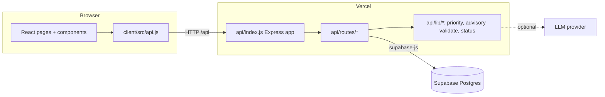
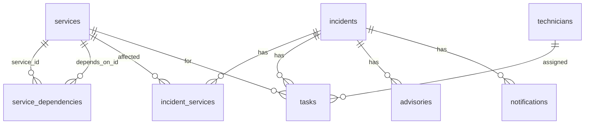

# Design Document

## Overview

CyberRecover is a hackathon MVP that runs one clean demo: a simulated attack hits a fictional bank, the incident manager sees ranked recovery priorities, assigns tasks, sends simulated notices, and customers see a public status page while technicians complete tasks and services return to `operational`.

Design goals, in order:

1. Follow the steering stack exactly: React (Vite, JavaScript) client, Express API as Vercel serverless functions under `/api`, Supabase Postgres, no ORM, no state library, no chart library.
2. Keep business rules in `api/lib/` as pure functions with no I/O, so they are easy to test and fast to write.
3. Keep routes thin: validate, call Supabase or a lib function, return JSON.
4. Make the demo flow in `product.md` work at every build step.

Research summary (no external research needed, stack is fixed by steering):

- Vercel runs an Express app when `api/index.js` exports it as the default export, so one export serves every `/api/*` path ([Vercel Express guide](https://vercel.com/guides/using-express-with-vercel)).
- `supabase-js` has no multi-statement transaction API. Requirements 4.9 and 12.7 ask for rollback, so multi-step writes use Postgres functions (RPC) defined in `schema.sql`, which run in one transaction ([Supabase RPC docs](https://supabase.com/docs/reference/javascript/rpc)). This is the one place we go beyond plain table queries.
- Vitest is the fastest test runner in a Vite project and `fast-check` is the standard property-based library for JavaScript.

## Architecture



Key decisions:

| Decision | Rationale |
|---|---|
| Client talks only to `/api`, never to Supabase | Keeps the service-role key on the server (Req 14.8). |
| Pure logic in `api/lib/` | Scoring, advisory safety, status derivation, and validation are testable without a database. |
| Multi-step writes (simulate, reset, task status change) are Postgres RPC functions | Gives real rollback (Req 4.9, 12.8) in one round trip. |
| Status derived on write, not on read | After each task change the API recomputes service and incident status and persists it, so every reader sees the same state. |
| Polling only on the public status page (30 s) | Matches Req 9.6 and 18.2. Other views use manual refresh. |
| Role switcher is local React state | Req 5. Not security, stated in the README. |

Local dev: `npm run dev` uses `concurrently` to start Vite (client) and `node api/dev.js`-style listener. To honour the layout, `api/index.js` exports the app and also calls `app.listen` when `process.env.VERCEL` is not set. Vite proxies `/api` to the local API port so CORS is unnecessary in dev; CORS is still limited to the Vite origin (Req 13.7).

## Components and Interfaces

### Backend files (`api/`)

| File | Responsibility |
|---|---|
| `index.js` | Builds the Express app, JSON body limit 100 KB, mounts routers, JSON 404 for unknown `/api/*`, central error handler. Checks env at startup (Req 14.6). |
| `lib/supabase.js` | Creates the supabase-js client from `SUPABASE_URL` and `SUPABASE_SERVICE_ROLE_KEY`. |
| `lib/priority.js` | `scoreServices(services, dependencies)`. Pure. |
| `lib/advisory.js` | `buildTemplateDraft`, `containsCredentialRequest`, `findUnverifiedChannels`, `generateAdvisory`. |
| `lib/validate.js` | `validateBody(schema, body)` plus the `TASK_STATUSES`, `AUDIENCES` and similar enums. |
| `lib/status.js` | Pure helpers: `progressPercent`, `deriveServiceStatus`, `shouldResolveIncident`, `toPublicStatus`. Added to keep Req 12 and 9 logic out of routes. This is one extra file beyond `structure.md`, justified by the rule that business logic lives in `api/lib/`. |

### Routes

| Route file | Endpoints | Notes |
|---|---|---|
| `services.js` | `GET /api/services` | Joins `service_dependencies`, returns `dependencies: [names]`. |
| `incidents.js` | `GET /api/incidents/active`, `POST /api/incidents/simulate`, `POST /api/incidents/reset` | Simulate and reset call RPC functions. Active calls `scoreServices`. |
| `tasks.js` | `GET /api/tasks`, `POST /api/tasks`, `PATCH /api/tasks/:id` | PATCH calls RPC `update_task_and_recompute` which updates the task, then service and incident status, in one transaction. |
| `technicians.js` | `GET /api/technicians` | |
| `advisories.js` | `POST /api/advisories/generate`, `POST /api/advisories` | Generate never writes. Save runs safety checks before insert. |
| `notifications.js` | `GET /api/notifications`, `POST /api/notifications` | GET is needed for the log (Req 8.5); it is a small addition to the steering API list. |
| `public.js` | `GET /api/public/status` | Uses `toPublicStatus`. No auth. |

Error format everywhere: `{ "error": "message" }`. Status codes: 400 validation, 404 missing task, 409 incident already active, 500 unexpected (generic message, no stack, no secrets).

### Key function contracts

```js
// priority.js
scoreServices(services, dependencies)
// services: [{ id, name, criticality, customer_impact }]  (affected services only)
// dependencies: [{ service_id, depends_on_id }]
// returns { list: [{ rank, service_id, name, score, reason }], cycleDetected: boolean }
```

Algorithm:

1. `dependents_count` = number of rows in `dependencies` whose `depends_on_id` is the service (direct dependents, counted across all services as the requirement defines "services that depend on it", restricted to the supplied edge list; the route passes all edges from the database).
2. `score = criticality*3 + customer_impact*2 + dependents_count*2`.
3. Build a graph of edges between affected services only. Run a Kahn-style topological sort. At each step, among services with no unprocessed dependency, pick the highest score, ties broken by name using plain `<` string comparison (code point order, Req 3.3).
4. If services remain after the sort (a cycle), append them ordered by score desc then name, and set `cycleDetected = true`.
5. `reason`: `Criticality ${c}, customer impact ${i}, ${d} dependent service(s); score ${s}`. Names are not included, so the length stays under 200 characters.

Because a dependency is always chosen before any dependent, the rule in Req 3.2 holds for direct and transitive dependents. Empty input returns `{ list: [], cycleDetected: false }`.

```js
// status.js
progressPercent(tasks)                    // Math.round(done/total*100), 0 when total is 0
deriveServiceStatus(service, tasks)       // see table below
shouldResolveIncident(affectedServices)   // every service operational
toPublicStatus({services, advisories, channels, tips})
```

`deriveServiceStatus` rules (applied in order after any task change):

| Condition | Result |
|---|---|
| tasks.length ≥ 1 and all `done` | `operational`, `restored_by_tasks = true` |
| any task `in_progress` | `recovering`, `restored_by_tasks = false` |
| service was `operational` because of tasks and a task left `done` | `recovering` |
| otherwise | unchanged |

```js
// advisory.js
generateAdvisory({ affectedServices, verifiedChannels, llmKey, llmClient })
// returns { title, body, source: 'template' | 'llm', fallback: boolean }
```

Flow: build template draft. If `llmKey` is empty, return it. Otherwise call the LLM with a 15 s timeout, then run `containsCredentialRequest` and `findUnverifiedChannels` on the output. If the call fails, times out, returns empty text, or fails a check, discard the output and return the template with `fallback: true`. The LLM client is injected so tests can stub it.

`containsCredentialRequest(text)`: splits into sentences; flags a sentence that contains `password|pin|otp` (case-insensitive, word boundary) and a verb from `provide|send|enter|share|give|submit|tell|reply`, unless the sentence also contains a negation (`never|do not|don't|will not|won't`). The negation allowance lets the security tips ("never share your OTP") pass.

`findUnverifiedChannels(text, verifiedChannels)`: extracts phone numbers, URLs, and emails with simple regexes and returns those not present in the verified list's `contact` values.

### Client files (`client/src/`)

| File | Responsibility |
|---|---|
| `App.jsx` | `useState` for role, router, role switcher, role-based nav, redirect to role default page when the current page is not allowed (Req 5.7). `/status` route is always reachable. |
| `api.js` | `request(path, options)` wrapper: base URL from `import.meta.env.VITE_API_BASE_URL || '/api'`, 10 s timeout via `AbortController`, throws `Error(message)` using the API `error` field. |
| `pages/Dashboard.jsx` | Service list with badges and dependencies, priority list, Simulate/Reset buttons (disabled while pending), refresh with error and retry. |
| `pages/Communication.jsx` | Generate draft, editable form, save draft/published, notify form with confirm prompt, notification log. Shows "restored advisory" control when the incident is resolved. |
| `pages/Recovery.jsx` | Overall and per-service progress bars (div width, no library), tasks grouped by service, create task form, assignee and status controls. |
| `pages/MyTasks.jsx` | Technician selector, own tasks, status select. |
| `pages/CustomerStatus.jsx` | Public page, `setInterval` 30 s polling, keeps old data on failure. Always shows static security tips. |
| `components/` | `StatusBadge`, `SeverityBadge`, `ProgressBar`, `ServiceCard`, `TaskRow`. |

State: each page owns its data with `useState` and `useEffect`. No shared store. Pages that need the same data (Dashboard, Recovery) refetch on mount and after each write.

## Data Models

Tables follow `tech.md`. Additions needed by the requirements are marked.



| Table | Columns and constraints |
|---|---|
| `services` | `id uuid pk`, `name text unique`, `description`, `criticality int check 1-5`, `customer_impact int check 1-5`, `status text check in (operational, degraded, down, recovering)`, `severity text check in (low, medium, high, critical)` (nullable when operational), `restored_by_tasks boolean default false` (added for Req 12.4/12.5) |
| `service_dependencies` | `service_id fk`, `depends_on_id fk`, `pk(service_id, depends_on_id)`, `check (service_id <> depends_on_id)` (Req 2.5) |
| `technicians` | `id`, `name`, `role`, `email` |
| `incidents` | `id`, `title`, `status check in (active, resolved)`, `started_at`, `resolved_at`; partial unique index on `status` where `status = 'active'` to enforce one active incident |
| `incident_services` | `incident_id fk`, `service_id fk`, pk on both |
| `tasks` | `id`, `incident_id fk`, `service_id fk`, `title text check length 1-200`, `technician_id fk null`, `status check in (todo, in_progress, done, blocked) default todo` |
| `advisories` | `id`, `incident_id fk null`, `title`, `body`, `status check in (draft, published)`, `created_at` |
| `notifications` | `id`, `incident_id fk null`, `audience check in (customers, technicians)`, `message`, `sent_at default now()` |
| `alt_channels` | `id`, `name`, `type`, `contact`, `verified boolean` |

Foreign keys that reference incidents use `on delete cascade` so reset can delete incident-linked rows cleanly.

### Postgres functions (in `schema.sql`)

| Function | Behaviour (single transaction) |
|---|---|
| `simulate_attack()` | Raises if an active incident exists (API maps to 409). Inserts one incident, inserts `incident_services` for a fixed preset (Core Banking, Online Banking, Mobile App, Fund Transfer, Card Payments), sets their status and severity from a fixed preset, inserts preset tasks (at least one per affected service), returns the incident. |
| `reset_demo()` | Sets all services `operational`, `severity = null`, `restored_by_tasks = false`; deletes tasks, advisories, notifications, `incident_services`, incidents; succeeds with no change when nothing is active. |
| `update_task_and_recompute(task_id, patch jsonb)` | Updates the task, loads the service's tasks, applies the rules from `deriveServiceStatus` (mirrored in SQL), sets the incident to `resolved` with `resolved_at = now()` when all affected services are operational, returns the updated task. |

Duplication note: the status rules exist in `status.js` (tested) and in the SQL function. To avoid drift and keep the MVP small, the SQL function is the source of truth at runtime, and `status.js` is used for the progress percentage, the public status shape, and as the reference implementation for tests. If time is short, replace the RPC with route code that reads tasks, calls `deriveServiceStatus`, and writes with plain supabase-js calls; this drops atomic rollback for Req 12.8 and should be documented as a known limitation.

### API shapes (selected)

```jsonc
// GET /api/incidents/active
{ "incident": { "id": "...", "status": "active", "started_at": "..." } | null,
  "services": [ { "id", "name", "status", "severity" } ],
  "priority": [ { "rank": 1, "service_id": "...", "name": "Core Banking", "score": 29, "reason": "..." } ],
  "cycleDetected": false }

// POST /api/advisories/generate  -> { "title", "body", "source": "template", "fallback": false }
// POST /api/advisories           <- { "title", "body", "status": "draft" | "published", "incident_id"? }
// GET  /api/public/status
{ "services": [ { "name", "status" } ],
  "advisory": { "title", "body", "created_at" } | null,
  "channels": [ { "name", "type", "contact" } ],
  "tips": [ "..." ] }
```

Security tips are a constant array in `status.js` containing the phishing warning, the never-share-OTP statement, and the official-channels statement (Req 9.4).

## Correctness Properties

*A property is a characteristic or behavior that should hold true across all valid executions of a system-essentially, a formal statement about what the system should do. Properties serve as the bridge between human-readable specifications and machine-verifiable correctness guarantees.*

These tests target the pure functions in `api/lib/`. Routes, RPC functions, React pages, schema, deployment, and environment handling use example-based and manual checks (see Testing Strategy). The steering file requires tests for the priority scorer only, so the first five properties (priority scoring) are required and the remaining ones are optional if time remains.

After reflection, redundant criteria were merged: the credential detector criteria (7.1, 7.4) are one property, the channel criteria (7.2, 7.5) are one property, the template draft criteria (6.2, 7.1, 7.2) are one property, the LLM fallback criteria (6.4, 7.6, 7.7) are one property, and the progress criteria (12.1 to 12.3) are one property.

### Property 1: Priority score matches the formula

For any affected service with criticality in 1 to 5, customer impact in 1 to 5, and any dependents count in 0 to 100, the score returned by `scoreServices` equals `criticality * 3 + customer_impact * 2 + dependents_count * 2`.

**Validates: Requirements 3.1**

### Property 2: Dependencies rank above all dependents

For any set of affected services with an acyclic dependency graph, every service appears in the ranked list before each of its direct and transitive dependents, and ranks are consecutive integers starting at 1.

**Validates: Requirements 3.2, 3.6**

### Property 3: Ranking is deterministic and breaks ties by name

For any set of affected services and dependencies, shuffling the input order does not change the output list, and any two adjacent services that are not ordered by a dependency and have equal scores appear in ascending code point order of name.

**Validates: Requirements 3.3**

### Property 4: Reason string is a bounded single line with the inputs

For any affected service, including names up to 200 characters, the returned reason is a single line of at most 200 characters that contains the service's criticality, customer impact, and dependents count.

**Validates: Requirements 3.4**

### Property 5: Cycles are reported and every service is still ranked

For any set of services and dependencies, possibly containing cycles, `scoreServices` terminates, returns every input service exactly once, and sets `cycleDetected` to true if and only if the dependency graph among the affected services contains a cycle. An empty input returns an empty list with `cycleDetected` false.

**Validates: Requirements 3.8, 3.9**

### Property 6: Credential requests are detected

For any text, `containsCredentialRequest` returns true when some sentence asks the reader to provide, send, enter, or share a password, PIN, or OTP without a negation, and returns false for sentences that only warn the reader never to share them.

**Validates: Requirements 7.1, 7.4**

### Property 7: Unverified channels are detected

For any advisory body and any list of verified channels, `findUnverifiedChannels` returns exactly the phone numbers, URLs, and email addresses in the body that are not in the verified list, so a body containing only verified channels returns an empty list.

**Validates: Requirements 7.2, 7.5**

### Property 8: Template draft is complete and safe

For any set of affected services and any set of channels with mixed verified flags, the template draft names every affected service, contains every verified channel, contains no unverified channel, contains no unresolved placeholder text such as `{{` or `undefined`, and contains no credential request.

**Validates: Requirements 6.2, 7.1, 7.2**

### Property 9: Generated advisory is always safe

For any LLM stub outcome (throws, times out, returns empty text, returns arbitrary text), the draft returned by `generateAdvisory` passes both safety checks, and `fallback` is true whenever the LLM output was discarded.

**Validates: Requirements 6.4, 7.6, 7.7**

### Property 10: Progress percentage is bounded and exact

For any list of tasks, `progressPercent` returns an integer from 0 to 100 equal to the rounded ratio of `done` tasks to all tasks, and returns 0 for an empty list.

**Validates: Requirements 12.1, 12.2, 12.3**

### Property 11: Service status follows task statuses

For any non-empty list of tasks for a service, `deriveServiceStatus` returns `operational` if and only if every task is `done`, and returns `recovering` when any task is `in_progress` and not all are `done`. For an empty task list the status is unchanged.

**Validates: Requirements 12.4, 12.6**

### Property 12: Request validation accepts exactly the valid bodies

For any request body, `validateBody` accepts a notification if and only if the audience is `customers` or `technicians` and the trimmed message length is 1 to 500, and accepts a task if and only if the title length is 1 to 200 and a service identifier is present. Rejections name the first invalid field.

**Validates: Requirements 8.2, 8.3, 10.2, 10.9, 13.1, 13.3**

### Property 13: Public status never leaks private data

For any services, advisories, and channels, `toPublicStatus` returns only service names and statuses, the single published advisory with the latest `created_at` (or null), only verified channels, and the tips; it contains no draft advisory, criticality, customer impact, task, or technician fields.

**Validates: Requirements 7.3, 9.1, 9.2**

## Error Handling

| Situation | Behaviour |
|---|---|
| Malformed JSON, body over 100 KB | Express body parser error mapped to 400 `{ error }` (Req 13.2). |
| Missing or invalid field, bad enum, string over 1,000 chars | 400 naming the first invalid field. No write happens. |
| Credential request or unverified channel in saved advisory | 400 with the message required by Req 7.4 or 7.5. Nothing stored. |
| Simulate while an incident is active | RPC raises a specific error code; route returns 409. |
| Task or technician reference not found | 400 for bad reference on POST/PATCH, 404 when `:id` task does not exist. |
| RPC or database failure | Transaction rolls back; route returns 500 `{ error: "Operation failed" }`. The real error is logged without secrets. |
| Unknown `/api/*` path | JSON 404 from the API, never the client HTML (Req 17.5). `vercel.json` routes `/api/(.*)` to `api/index.js` first. |
| Missing `SUPABASE_URL` or `SUPABASE_SERVICE_ROLE_KEY` at startup | Process exits and lists the missing variable names only. `LLM_API_KEY` is optional. |
| LLM failure or unsafe output | Template fallback with `fallback: true`; the Client shows a notice. |
| Client request fails or exceeds 10 s | `api.js` throws; the page shows an error message, keeps the previous data, and re-enables buttons. |
| Status page refresh fails | Keeps old data, shows "could not refresh", retries at the next 30 s tick. First load failure shows "status unavailable" and still shows the tips. |

Logging never prints the service-role key or LLM key. Errors returned to clients are generic strings only.

## Testing Strategy

### Approach

- Property-based testing applies to the pure functions in `api/lib/` (Properties 1 to 13). It does not apply to Express routes, Postgres functions, React rendering, the schema, deployment, or environment handling, which are mostly I/O or UI.
- Libraries: Vitest as the runner and `fast-check` for properties. No property-based framework is written from scratch.
- Each property is implemented as one `fc.assert(fc.property(...))` test with at least 100 runs (the fast-check default of 100 is kept explicit with `{ numRuns: 100 }`).
- Each test carries a comment tag: `Feature: bank-cyber-recovery-platform, Property N: <property text>`.
- Priority: the steering file says to write tests only for the priority scorer. Write Properties 1 to 5 plus example tests for the empty-incident case first (Req 3.10). Properties 6 to 13 are optional and are added only if time remains.

### Unit (example) tests

- Priority scorer: a known three-service example (Core Banking, Mobile App, Online Banking) with expected order and scores; empty input.
- Security tips text contains phishing, OTP, and official-channels statements.
- Badge colour mapping has unique colours per value (Req 1.2).

### Integration and manual checks (not property-based)

| Area | Check |
|---|---|
| Schema and seed | Run `schema.sql` then `seed.sql` on an empty Supabase project; confirm 7 services plus a database service, at least 3 technicians and 3 verified channels, no incidents (Req 15). |
| Simulate and reset | Call simulate twice (second returns 409), reset twice (both succeed), confirm services return to `operational` (Req 4). |
| Task rollup | Mark all tasks of one service `done`; confirm the service becomes `operational`; finish all services and confirm the incident becomes `resolved` (Req 12). |
| Public status | `curl /api/public/status` and confirm no draft advisories or private fields (Req 9.2). |
| Secrets | Search the built client bundle for `SERVICE_ROLE` and `LLM_API_KEY`; confirm `.env` is ignored by git (Req 14). |
| Deploy | Hit `/` and `/api/services` on the Vercel URL; hit `/api/unknown` and confirm JSON 404 (Req 17). |
| Demo run-through | Follow the README demo script, steps 1 to 9 (Req 16). |

### Build order alignment

This design follows the order in `structure.md`: schema and seed, then API and scoring (with Properties 1 to 5), Dashboard, tasks and Recovery pages, advisories and the status page, then deploy and README. The optional properties and the RPC-to-route-code fallback are the first things to cut if time runs short.
